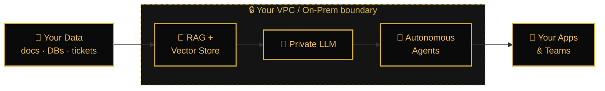
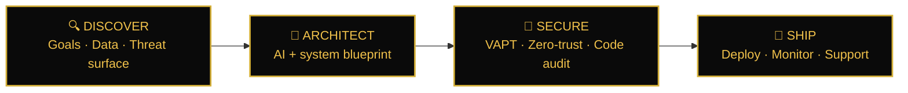

<a name="top"></a>

<!-- ═══════════════════════ HERO ═══════════════════════ -->


<div align="center">


<a href="https://futuristictech.top">
  
</a>

<br/>


<br/><br/>

<a href="https://futuristictech.top"></a>
<a href="mailto:futuristictech1821@gmail.com"></a>
<a href="https://wa.me/923254414584"></a>

<br/><br/>

<!-- Quick-jump navigation -->
<a href="#services"></a>
<a href="#architecture"></a>
<a href="#process"></a>
<a href="#stack"></a>
<a href="#founder"></a>
<a href="#faq"></a>
<a href="#contact"></a>

</div>


<!-- ═══════════════════════ TERMINAL ═══════════════════════ -->

```text
┌──[ futuristic-tech@core ]──[ ~/mission ]
└─$ ./init --agency futuristic-tech

  [ OK ]  Private LLM & AI agents ............ ready
  [ OK ]  VAPT & zero-trust security ......... ready
  [ OK ]  iOS · Android · Flutter ............ ready
  [ OK ]  WebGL / Three.js experiences ....... ready
  [ OK ]  Fractional CTO leadership .......... ready

  status   : accepting new engagements
  mission  : ship intelligent systems that are secure by design
└─$ _
```


<!-- ═══════════════════════ ABOUT ═══════════════════════ -->

<h2 align="center">🚀 About</h2>

> **Futuristic Tech** is a high-assurance engineering agency for organizations that need intelligence *and* security in the same build.
> Founded and led by **Malik Ayan** (Chief AI Officer, Fractional CTO and Certified Ethical Hacker), we architect, secure and ship production systems end to end: from boardroom AI strategy to deployment, with security assurance built in from day one.


<!-- ═══════════════════════ CORE OFFERS ═══════════════════════ -->
<a name="services"></a>

<h2 align="center">⚡ Two Core Offers</h2>

<table>
<tr>
<td width="50%" valign="top">

### 🧠 Private LLM & AI Agents
*AI that runs on your data, inside your environment.*

- Private LLM deployment designed for **data sovereignty** in your VPC or on-prem
- **RAG** over proprietary data with vector search and access controls
- **Autonomous agents** for support, sales and operations workflows
- AI readiness audit with use-case prioritization and ROI

</td>
<td width="50%" valign="top">

### 🛡️ VAPT & Security Assurance
*Find the weaknesses before an attacker does.*

- **Web, API, cloud and mobile** penetration testing
- Black-box, grey-box and **red-team** engagements
- **Source code audit**: SAST plus manual review
- Executive report, **remediation roadmap and retest**

</td>
</tr>
</table>

<a name="architecture"></a>

<h3 align="center">How a Private AI stack looks</h3>




<!-- ═══════════════════════ EXPLORE SERVICES (interactive) ═══════════════════════ -->

<h2 align="center">🧩 Explore Everything We Build</h2>

<p align="center"><sub>👇 Click any section to expand</sub></p>

<details open>
<summary><b>🧠 AI Strategy & Leadership</b> &nbsp;·&nbsp; <code>Chief AI Officer</code> <code>Fractional CTO</code></summary>
<br/>

| Service | What you get |
|---|---|
| **Enterprise AI Consulting** | Readiness audit, roadmap and ROI model |
| **Private LLM Deployment** | Data-sovereign models in your own environment |
| **Autonomous AI Agents** | Multi-step workflow execution with human-in-the-loop controls |
| **RAG & Vector Architecture** | Retrieval over your proprietary knowledge |
| **Fractional CTO** | Senior technical leadership without a full-time hire |

</details>

<details>
<summary><b>🛡️ Cybersecurity & Assurance</b> &nbsp;·&nbsp; <code>Certified Ethical Hacker</code></summary>
<br/>

| Service | What you get |
|---|---|
| **VAPT Audits** | Web, API, cloud and mobile assessments |
| **Penetration Testing** | Black-box, grey-box and red-team |
| **Zero-Trust Hardening** | Identity-first network and access design |
| **Source Code Security Audit** | SAST plus manual expert review |
| **Mobile App VAPT** | Security testing before every release |

</details>

<details>
<summary><b>📱 Mobile Engineering</b> &nbsp;·&nbsp; <code>Swift</code> <code>Kotlin</code> <code>Flutter</code></summary>
<br/>

| Service | What you get |
|---|---|
| **iOS** | Native Swift apps |
| **Android** | Modern Kotlin engineering |
| **Flutter** | One codebase, native feel |

</details>

<details>
<summary><b>🌐 Interactive 3D Web</b> &nbsp;·&nbsp; <code>WebGL</code> <code>Three.js</code></summary>
<br/>

| Service | What you get |
|---|---|
| **3D WebGL Design** | Immersive, high-performance web experiences |
| **Real-time Configurators** | Interactive 3D product configurators |

</details>

<details>
<summary><b>⚙️ Automation & Data</b> &nbsp;·&nbsp; <code>Invoicing</code> <code>BI</code></summary>
<br/>

| Service | What you get |
|---|---|
| **Invoicing & Compliance Automation** | Automated invoicing engines |
| **Big Data Analytics & BI** | Pipelines and dashboards |

</details>


<!-- ═══════════════════════ PROCESS ═══════════════════════ -->
<a name="process"></a>

<h2 align="center">🗺️ How We Work</h2>




<!-- ═══════════════════════ WHY US + ENGAGEMENT ═══════════════════════ -->

<h2 align="center">⭐ Why Teams Choose Us</h2>

<table>
<tr>
<td align="center" width="25%"><h3>🧠</h3><b>AI-First</b><br/><sub>Private LLMs and agents engineered around your data</sub></td>
<td align="center" width="25%"><h3>🛡️</h3><b>Security-Led</b><br/><sub>Every build is tested the way an attacker would test it</sub></td>
<td align="center" width="25%"><h3>👤</h3><b>Senior Leadership</b><br/><sub>One accountable technical lead, strategy to launch</sub></td>
<td align="center" width="25%"><h3>🏢</h3><b>Built for Scale</b><br/><sub>Designed for regulated, high-stakes environments</sub></td>
</tr>
</table>

<h3 align="center">Engagement Models</h3>

<table>
<tr>
<td align="center" width="33%"><h3>🎯</h3><b>Fixed-Scope Audit</b><br/><sub>Defined scope, timeline and report</sub></td>
<td align="center" width="33%"><h3>🧭</h3><b>Fractional CTO Retainer</b><br/><sub>Monthly embedded leadership</sub></td>
<td align="center" width="33%"><h3>🏗️</h3><b>Project-Based Build</b><br/><sub>AI, mobile or 3D web with milestones</sub></td>
</tr>
</table>

<p align="center"><sub>🔒 All engagements are conducted under NDA.</sub></p>


<!-- ═══════════════════════ STANDARDS ═══════════════════════ -->

<h2 align="center">📋 Standards & Methodology</h2>

<div align="center">


</div>


<!-- ═══════════════════════ TECH STACK ═══════════════════════ -->
<a name="stack"></a>

<h2 align="center">🛠️ Tech Arsenal</h2>

<div align="center">

<b>Apps & Infrastructure</b><br/><br/>


<br/><br/>

<b>AI & LLM</b><br/><br/>


<br/><br/>

<b>Security</b><br/><br/>


</div>


<!-- ═══════════════════════ CASE STUDIES ═══════════════════════ -->

<h2 align="center">📁 Case Studies</h2>

<p align="center">Detailed case studies and redacted sample reports are available on request under NDA.<br/>
<a href="mailto:futuristictech1821@gmail.com?subject=Case%20studies%20request"><b>Request case studies →</b></a></p>

<!--
  Jab real case study ho, yahan add karo:

  <details>
  <summary><b>Private LLM for a FinTech compliance team</b></summary>
  <br/>
  <b>Problem:</b> ...<br/>
  <b>Solution:</b> ...<br/>
  <b>Result:</b> ...
  </details>
-->


<!-- ═══════════════════════ FOUNDER ═══════════════════════ -->
<a name="founder"></a>

<h2 align="center">👑 The Founder</h2>

<div align="center">

<!-- Circle crop automatically (wsrv.nl). Agar photo na dikhe to neeche wali fallback line use karo -->

<!--  -->

### Malik Ayan


</div>

> Malik is a systems architect working at the intersection of applied AI and enterprise security. As a Fractional CTO and Enterprise AI Consultant, he leads organizations through private LLM deployment, autonomous agent engineering and zero-trust security transformation, giving leadership a single, accountable technical lead for their most ambitious initiatives.


<!-- ═══════════════════════ FAQ ═══════════════════════ -->
<a name="faq"></a>

<h2 align="center">❓ FAQ</h2>

<details>
<summary><b>What is a Fractional CTO / Chief AI Officer?</b></summary>
<br/>
Executive-level technology leadership on a part-time, embedded basis. You get senior AI and engineering strategy without the cost of a full-time hire.
</details>

<details>
<summary><b>Can you deploy LLMs inside our own infrastructure?</b></summary>
<br/>
Yes. We specialize in private LLM deployment inside your VPC or on-prem, designed so your data stays under your control.
</details>

<details>
<summary><b>What does a VAPT engagement include?</b></summary>
<br/>
Vulnerability assessment and penetration testing across web, API, cloud and mobile, with an executive report, remediation guidance and a retest.
</details>

<details>
<summary><b>Which platforms do you build for?</b></summary>
<br/>
Native iOS (Swift), Android (Kotlin), cross-platform Flutter, and interactive 3D web with WebGL and Three.js.
</details>

<details>
<summary><b>How do we get started?</b></summary>
<br/>
Message us on WhatsApp or email. We review your goals and constraints, then propose a scope, timeline and engagement model.
</details>

<details>
<summary><b>Do you sign NDAs?</b></summary>
<br/>
Yes. All engagements are conducted under NDA.
</details>


<!-- ═══════════════════════ CONTACT ═══════════════════════ -->
<a name="contact"></a>

<h2 align="center">📬 Let's Talk</h2>

<div align="center">

<sub>Tell us what you want to build or secure. We reply with a clear plan.</sub>

<br/><br/>


<a href="mailto:futuristictech1821@gmail.com"></a>
<a href="https://wa.me/923254414584"></a>
<a href="https://futuristictech.top"></a>

<br/>

<a href="#top"></a>

</div>

<!-- ═══════════════════════ FOOTER ═══════════════════════ -->

